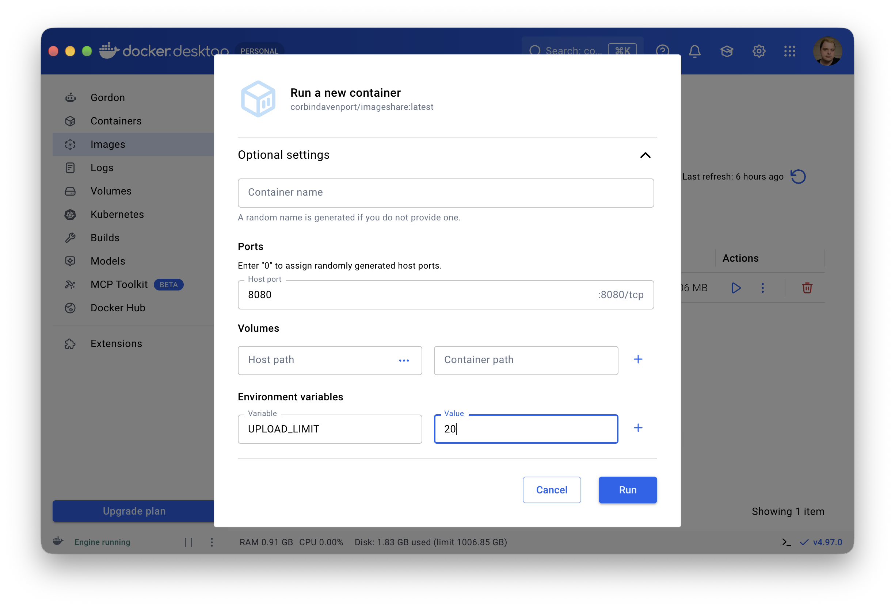

# Installing ImageShare

This page explains how to install ImageShare on your own computer, NAS, or home server. If you're new to self-hosting and containers, try the [Docker Desktop method](#docker-desktop).

For running ImageShare on a public web server, see the [production guide](PROD.md).

## Docker Compose

Docker Compose is the recommended method of running ImageShare. If you're not familiar with it, check the [official starter guide](https://docs.docker.com/get-started/docker-concepts/the-basics/what-is-docker-compose/). You can install it as part of [Docker Engine](https://docs.docker.com/engine/install/) on Linux, or [Docker Desktop](https://docs.docker.com/desktop/) on macOS and Linux.

First, create a working directory for ImageShare and switch to it, like this on Linux or macOS:

```shell
mkdir ~/imageshare
cd ~/imageshare
```

Next, download the [Docker Compose example file](https://raw.githubusercontent.com/corbindavenport/imageshare/refs/heads/main/doc/docker-compose.yaml) with the `curl` command:

```shell
curl "https://raw.githubusercontent.com/corbindavenport/imageshare/refs/heads/main/doc/docker-compose.yaml" -o docker-compose.yaml
```

You can open the file in your preferred text editor to change any options. The default port for the web server is `8080`. For more details on how to use the environment variables, see the [settings documentation](SETTINGS.md).

Start the container with this command:

```shell
docker compose up
```

ImageShare will be accessible at `http://localhost:8080` in your computer's web browser (unless you changed the port). Other devices on your network can open it by replacing `localhost` with your computer's local IP address.

To shut down the container, run this command:

```shell
docker compose down
```

You can update ImageShare in the future by running the `docker-compose pull` command. The containers need to be shut down first.

For examples of running ImageShare in Docker Compose with HTTPS support, see the [production server guide](PROD.md).

## Docker Desktop

You can also run ImageShare in [Docker Desktop](https://www.docker.com/products/docker-desktop/) on Windows, Mac, and desktop Linux.

First, open ImageShare in Docker Desktop by [clicking here](https://open.docker.com/dashboard/docker-hub/image?name=corbindavenport/imageshare&type=image&tag=latest) or by typing "corbindavenport/imageshare" in the search bar at the top of the window. Make sure the "latest" tag is selected, then click the "Pull" button. Wait for the download to finish.

Next, create the container by selecting the "Images" tab in Docker Desktop, finding ImageShare in the list, and clicking the Run ▶️ button.

In the popup that opened, expand the Optional settings section, and set these values:

- **Container Name:** You can leave it blank, or set it to "imageshare".
- **Ports:** Set the "Host port" to `8080` or another available port.
- **Environment variables:** `UPLOAD_LIMIT` for the first variable, and `20` for its value. This will set the upload limit to 20 MB, but you can set it higher if you want. Check the [settings documentation](SETTINGS.md) for a full list of options.

Finally, click the "Run" button to start the container.



ImageShare will be accessible at `http://localhost:8080` in your computer's web browser, and other devices on your network can open it by replacing `localhost` with your computer's local IP address. 

You can stop the server by clicking the Stop ⏹️ button in Docker Desktop. To start it again, find the container you made in the Containers tab of Docker Desktop and click the Start ▶️ button.

## Docker CLI

If you have the [Docker Engine](https://docs.docker.com/engine/install/) installed, you can run ImageShare like this:

```bash
docker run -p 8080:8080 --env UPLOAD_LIMIT=20 docker.io/corbindavenport/imageshare:latest
```

ImageShare will be accessible at `http://localhost:8080` in your computer's web browser, and other devices on your network can open it by replacing `localhost` with your computer's local IP address. 

Check the [settings documentation](SETTINGS.md) for a full list of options you can add as environment variables.

## Apple Container

You can run ImageShare in [Apple's Container tool](https://github.com/apple/container) on an Apple Silicon Mac, as an alternative to Docker Desktop or the Docker CLI. The tool is available from [GitHub](https://github.com/apple/container/releases) or [Homebrew](https://formulae.brew.sh/formula/container).

After the tool is installed, start the Container service, and install the recommended kernel if asked.

```shell
container system start
```

Log into Docker Hub, replacing `<USERNAME>` with your account username. You may need to [create a personal access token](https://docs.docker.com/security/access-tokens/personal-access-tokens/) and use that instead of a password.

```shell
container registry login --username <USERNAME> docker.io
```

Then you can download and run ImageShare with the `container run` command.

```shell
container run -p 8080:8080 --env UPLOAD_LIMIT=20 docker.io/corbindavenport/imageshare:latest
```

ImageShare will be accessible at `http://localhost:8080` in your computer's web browser, and other devices on your network can open it by replacing `localhost` with your Mac's local IP address. 

Check the [settings documentation](SETTINGS.md) for a full list of options you can add as environment variables.

## Bare metal (no container)

ImageShare can be run without a container, but this configuration isn't as well-tested. You need [Node.js](https://nodejs.org/), [exiftool](https://exiftool.org/), and [Git](https://git-scm.com/install/) installed on the host system.

First, clone the ImageShare repository to your system, replacing `main` with a specific [tagged version](https://github.com/corbindavenport/imageshare/tags) if desired:

```shell
git clone https://github.com/corbindavenport/imageshare.git -b main imageshare
cd imageshare
```

Next, install the Node.js dependencies:

```shell
npm install --ignore-scripts
```

Finally, run the server with Node: 

```
UPLOAD_LIMIT=20 npm start
```

ImageShare will be accessible at `http://localhost:8080` in your computer's web browser, and other devices on your network can open it by replacing `localhost` with your computer's local IP address.

Check the [settings documentation](SETTINGS.md) for a full list of options. The environment variables go before `npm` in the command.

To update ImageShare in the future, run `git pull` while in the `main` branch, or run `checkout` with a specific tagged version, then start the server again.